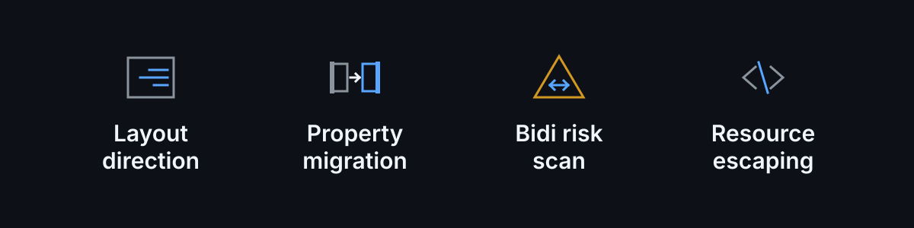
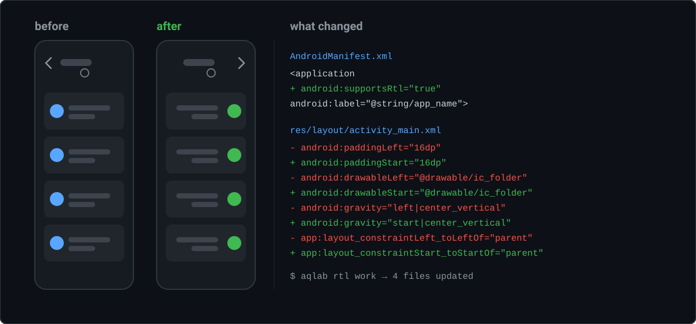

<div align="center">


**اقلب أي تطبيق أندرويد للعربي — باتجاه RTL صحيح — بأمر واحد.**

[](https://github.com/Gilgamesh-110/aqlab/actions/workflows/ci.yml)
[](https://pypi.org/project/aqlab/)
[](https://pypi.org/project/aqlab/)
[](LICENSE)
[](https://www.python.org/downloads/)
[](#المتطلبات)

**العربية** · [English](README.md)

</div>

---

ترجمة التطبيق للعربي هي النص السهل. النص اللي يغلطون فيه الجميع هو الواجهة:
القائمة الجانبية تبقى عاليسار، سهم الرجوع لسا يشير لليسار، شريط التقدم يمتلئ
بالعكس، الـ`%d` يضيع، وعلامات الترقيم تنتقل للجهة الغلط.

**`aqlab` يتولى الجزء اللي مو ترجمة** — اتجاه الواجهة، ترحيل الخصائص، مخاطر
الـbidi في Unicode، وتهريب موارد أندرويد.

<p align="center">
  
</p>

## جرّبها بسرعة

ما تحتاج APK ولا Android SDK لهذا الجزء — عندنا مشروع مفكوك صغير بالريبو،
ومقصود إنه يحتوي المصايد:

```sh
git clone https://github.com/Gilgamesh-110/aqlab && cd aqlab
python aqlab.py rtl   examples/demo-project
python aqlab.py apply examples/demo-project --tsv examples/ar.tsv
python aqlab.py lint  examples/demo-project
```

```
[PATCH] AndroidManifest.xml: android:supportsRtl="true"
[PATCH] res/layout/activity_main.xml: 11 attribute(s)
[PATCH] res/layout/list_item.xml: 6 attribute(s)
[PATCH] res/values/styles.xml: 2 attribute(s)
[DONE] 4 file(s) updated
[DONE] 12 translation(s) -> examples/demo-project/res/values-ar/strings.xml
[FINDING] lint res/values-ar: 12/12 translated (100.0%)
  [ERROR] plurals/selected_count: missing quantities: few (3-10), many (11-99) — those counts fall back to `other`
  [WARN] plurals/selected_count: no zero (0), two (2) form — those counts use `other`
[FAIL] 1 error(s), 1 warning(s)
```

هذا السطر الأخير هو سبب وجود الأداة. عربية المشروع التجريبي **مترجمة 100%
وبعدها غلط** بكل عدد فوق 2 — تكتب `3 عنصر` والمفروض `3 عناصر`، و`11 عنصراً`
فوق العشرة، و`لا عناصر` عند الصفر. ماكو نص ناقص، ولا خطأ بناء، ولا شي أي linter
عادي يبلّغ عنه.

فيه layout عنده `paddingLeft` **و** `paddingStart` سوا، و`<style>` يحمل الاتجاه
داخل قيمة `<item>`، ومرجع `?listPreferredItemPaddingLeft` — الثلاثة اللي تكسر أي
ترحيل ساذج.

<p align="center">
  
</p>

## المحتويات

- [جرّبها بسرعة](#جرّبها-بسرعة)
- [ليش](#ليش)
- [التنصيب](#التنصيب)
- [البدء السريع](#البدء-السريع)
- [الأوامر](#الأوامر)
- [شنو يصلّح](#شنو-يصلّح)
- [الجزء اللي ما يسويه غيرنا: فحص bidi](#الجزء-اللي-ما-يسويه-غيرنا-فحص-bidi)
- [شنو **ما** يسوي](#شنو-ما-يسوي)
- [علاقتها بالأدوات الثانية](#علاقتها-بالأدوات-الثانية)
- [مجرّب على](#مجرّب-على)
- [أسئلة متكررة](#أسئلة-متكررة)
- [المتطلبات](#المتطلبات)
- [المساهمة](#المساهمة)
- [الرخصة](#الرخصة)

## ليش

العربية تكتب من اليمين لليسار. وأندرويد عنده ميكانيزم جاهز لهذا من API 17 —
خصائص `start`/`end` المنطقية مع `android:supportsRtl` — ومع هذا نسبة كبيرة من
التطبيقات المنشورة ما شغّلته، أو شغّلته وخلّت مئات الخصائص `left`/`right` مكتوبة
بالثابت.

العمل اليدوي يعني تدقيق كل layout وكل menu وكل style، وتكتشف الأخطاء فقط لما
تفتح التطبيق بالعربي. `aqlab` يشتغل الـ95% الميكانيكية و**يفحص الباقي**، فتصير
أول نسخة عربية تفتحها صحيحة من أول مرة.

## التنصيب

```sh
pip install aqlab        # أو: pipx install aqlab
```

ملف واحد، مكتبة بايثون القياسية فقط، ماكو شي ثاني تنصّبه. ومتوفرة بلا مدير حزم بعد:

```sh
pipx install git+https://github.com/Gilgamesh-110/aqlab
```

يشتغل على أدوات عندك أصلاً:

| الأداة | كيف يلگاها |
|---|---|
| `apktool` | `AQLAB_APKTOOL=/path/to/apktool.jar`، وإلا `apktool` على `PATH` |
| `aapt2`, `zipalign`, `apksigner` | `ANDROID_HOME` / `AQLAB_SDK`، وإلا `PATH` |

وتكدر تتجاوز كل أداة لحالها: `AQLAB_AAPT2`, `AQLAB_ZIPALIGN`, `AQLAB_APKSIGNER`,
`AQLAB_JAVA`.

## البدء السريع

```sh
aqlab scan app.apk          # شنو حالة هذا التطبيق؟
```

```
[FINDING] apk: app.apk
  package        : com.example.app
  label          : 'Example'
  locales        : 87 -> --_--, af, am, ar, as, az, be, bg, bn, bs, ca, cs, da, de
  arabic present : yes
  supportsRtl    : no (or not detectable in binary XML)
  native libs    : 6 (renaming packages in native apps can break self-checks)
```

```sh
aqlab decode app.apk -o work        # فك التطبيق
aqlab rtl    work --dry-run         # عاين الترحيل قبل ما تطبّقه
aqlab rtl    work                   # طبّقه
aqlab scaffold work                 # -> work/values-ar.tsv  (الجدول خارج res/)
#     ... ترجم العمود الأخير (DeepL، LLM، أو مترجم بشري) ...
aqlab apply  work --tsv work/values-ar.tsv
aqlab lint   work                   # يرجع كود خطأ عند وجود أخطاء حقيقية
aqlab build  work --ks release.keystore --ks-alias release
```

أو كل شي بأمر واحد:

```sh
aqlab all app.apk --tsv ar.tsv --ks release.keystore --ks-alias release
```

## الأوامر

| الأمر | شيسوي |
|---|---|
| `scan <apk\|dir>` | تقرير للقراءة فقط: اللغات، `supportsRtl`، عدد `left/right` الباقية، نسبة التغطية. `--json` للأدوات. |
| `decode <apk>` | يفك الـAPK لمشروع قابل للتعديل. يتخطّى `smali/` افتراضياً — التفاصيل تحت. |
| `rtl <dir>` | يضبط `android:supportsRtl` ويحوّل `left/right` → `start/end` بكل `res/**`. `--dry-run` للمعاينة. |
| `scaffold <dir>` | ينشئ `res/values-<locale>/` وجدول ترجمة، و(API 33+) `res/xml/locales_config.xml` + `android:localeConfig`. يقرا **كل** `values/*.xml` مو `strings.xml` بس. `--dry-run` للمعاينة. |
| `apply <dir> --tsv` | يستورد الجدول المترجم إلى مجلد اللغة، وكل إدخال لملفه الأصلي. `--dry-run` للمعاينة. |
| `lint <dir>` | أخطاء التهريب، اختلاف الـformat specifiers، بنية صيغ الجمع، التغطية (الكل ولكل ملف)، الـvector اللي يشبه نص، و`RtlSymmetry` / `RtlHardcoded` / `DirectionPins` (اتجاه مثبّت على صف، أو على حاوية أطفالها تستخدم left/right)، ومجلدات `ldrtl` الفارغة أو اللي بيها نسخة مطابقة بالبايت للملف العادي. كود خروج غير صفري عند الأخطاء؛ `--fail-under` / `--fail-under-file` بوابة CI على التغطية؛ و`--fix` يكمّل الطرف الناقص (`paddingStart` مع `paddingEnd` مثلاً) ويحوّل قيم `gravity`/`textAlignment` اللي تشير لجهة فيزيائية إلى `start`/`end`، ويشيل تثبيت `layoutDirection="ltr"` اللي على الصف نفسه (مع تحويل خصائصه الفيزيائية)، أما تثبيت `rtl` فمقصود وينبقى، و`--fix --dry-run` يعرض الخطة بس. |
| `build <dir>` | `apktool b` → `zipalign` → `apksigner sign` → `apksigner verify` |
| `diff <a.apk> <b.apk>` | النصوص المضافة/المحذوفة/المتغيّرة بين APKين، مقروءة من جدول الموارد مباشرة. كود خروج غير صفري عند الاختلاف. |
| `xliff <dir>` | يلفّ كل format specifier بـ`<xliff:g>` حتى المترجم ما يقدر يعيد ترتيبه أو يحذفه. `--dry-run` للمعاينة. |
| `all <apk>` | السلسلة كاملة |

### السرعة، وليش `decode` يتخطّى `smali/`

تفكيك البايت كود يأخذ معظم وقت الفكّ، والأداة **ما تلمس الكود أبداً** — فنتخطّاه.
`apktool` يحفظ الـAPK الأصلي بـ`apktool.yml` ويرجّع ملفات `classes*.dex` الأصلية
عند البناء **بايت ببايت**؛ الدورة الكاملة تحت متحقَّقة بـ`sha256sum` على كل dex،
والـAPK الناتج يعدّي `apksigner verify` و `zipalign -c`.

مقيس على تطبيق حقيقي 17MB — شجرة 8,447 ملف، 125 layout، 210 ملف `values/`، 5 dex:

| الخطوة | مع `smali/` | الافتراضي | شنو تغيّر |
|---|---|---|---|
| `decode` | 52.1s | **10.0s** | تخطّي التفكيك |
| `build` | 65.3s | **27.0s** | ما بقى شي يُعاد تجميعه |
| `rtl` | 6.6s | **4.3s** | تخطّي الوسوم اللي ما تنترحّل |
| **الدورة كاملة** | ~117s | **51s** | موقّعة ومتحقَّق منها |

`rtl` أسرع لأن جداول التحويل جنت تشتغل على **كل خاصية بكل وسم**. هسا الوسم
يُتخطّى إذا ما بيه اسم من الأسماء اللي تعرفها الجداول، فوسوم `layout_width` و
`text` و `id` تكلّف بحث نصّي واحد. هذا قلّل نداءات بايثون من 692 ألف إلى 288 ألف
بنفس المخرجات بالبايت.

تخطّي `smali/` يصغّر شجرة العمل بعد من **123 MB / 8,447 ملف إلى 47 MB / 1,197 ملف**
— يعني كل نسخ وgrep وأرشفة وإعادة بناء تشتغل على شجرة أصغر بمرتبة كاملة.

تريد شجرة `smali/` بعد؟ `--with-sources` مع `decode` أو `all`.

## شنو يصلّح

* `android:supportsRtl="true"` على `<application>`
* `paddingLeft/Right` → `paddingStart/End`، ومثلها `layout_margin*`،
  `drawable*`، `layout_align*`، `layout_alignParent*`، `layout_to*Of`
* ConstraintLayout: `app:layout_constraint{Left,Right}_to{Left,Right}Of` → `{Start,End}`
* قيم `gravity` / `layout_gravity` / `foregroundGravity`
* `textAlignment` → `viewStart` / `viewEnd`
* عناصر `<item name="android:paddingLeft">` داخل `<style>`
* مراجع الـtheme اللي تبقى ترجع لقيمة LTR
  (`?listPreferredItemPaddingLeft` → `?…Start`)
* تهريب موارد أندرويد: `'`، و`@`/`?` بالبداية، والمسافات المهمة

كل تبديل محروس: لما الوسم يكون عنده التوأم `start`/`end` أصلاً، الخصيصة القديمة
**تنحذف** بدل ما تتكرر. هاي الحماية هي الفرق بين مشروع يبني ومشروع يموت داخل
`aapt2` بخطأ `error: duplicate attribute` — وهي السبب اللي يخلي الأداة تشتغل على
تصاميم AppCompat و Material، لأنها تجيب الاثنين سوا.

## bidi: شنو الفحص ما يدّعي

خلط العربي مع اللاتيني بنفس النص شائع، وغالباً صح. `الإصدار 2.1` يظهر مثل ما
يتوقع القارئ بلا أي مساعدة، وكذلك `المجلد test.`.

النسخ القديمة من الأداة بلّغت عن هاي كأخطاء bidi ووصفت `U+200F`. كان غلط،
والقياس كان غلط:

| | الادعاء | القياس |
|---|---|---|
| نصوص مفحوصة | — | 200 نص مختلط من APK منشور |
| الجهاز | — | أندرويد 11، `TextView`، `TEXT_DIRECTION_RTL` |
| عيوب موجودة | 58 error، بعدين 534 finding | **صفر** |

كل حرف: اتجاهه المحسوب وحدوده الأفقية، مقروءة من `android.text.Layout`
المُرتَّب ومقارنة بـUAX #9. النقطة بنهاية `المجلد test.` أصلاً على يسار `test`
— وهذا مكانها الصح؛ إدخال `U+200F` قبلها ما حرّك شي.

الفحص انشال. اللي يبلّغ عنه `lint` هسه هو اللي يكدر يثبته:

```
[FINDING] lint res/values-ar: 148/190 translated (77.9%)
  [ERROR] discount: bare `%` — must be `%%` or a format specifier, aapt will reject it
  [ERROR] welcome: format specifiers differ: source ['%1$s'] vs arabic ['%s']
  [ERROR] note: unescaped apostrophe — use \' inside Android string resources
  [ERROR] plurals/selected_count: missing quantities: few (3-10), many (11-99)
[FAIL] 4 error(s), 1 warning(s)
```

إذا لكيت نص يظهر غلط على الجهاز فعلاً، هذا بلاغ يستاهل — مع النص والجهاز
وصورة. مو شي الأداة تخمّنه.

| القاعدة | المستوى |
|---|---|
| اختلاف الـformat specifiers عن المصدر | error |
| `%` عارية يرفضها `aapt` | error |
| `'` غير مهربة داخل مورد نصي | error |
| القيمة تبدأ بـ`@` أو `?` | error |
| اختلاف وسوم markup (`<b>`، `<xliff:g>`) عن المصدر | error |
| `<plurals>` عربية ناقصة `other` أو `few` أو `many` | error |
| القيمة مطابقة للمصدر وفيها لاتيني | warn |
| ما بيه حروف عربية بالقيمة العربية | warn |
| فرق بالمسافات بالبداية أو النهاية | warn |
| `few` / `many` / `other` بنفس النص بالضبط | warn |
| `<plurals>` عربية ناقصة `zero` أو `two` | warn |
| vector drawable يشبه نص | warn |
| خلط عربي + لاتيني بنفس النص | info |

### الـvectors اللي بيها نص مرسوم

شعار لاتيني مرسوم بـ`<path>` ما ينقلب مع الواجهة — الشاشة كلها تنقلب والشعار
يضل مقلوب. `lint` و`scan` يبلّغون عنه، وما يلمسون الرسم أبداً.

ثلاث شروط لازم تتحقق كلها، لأن التحذير على ملف سليم يعلّم المستخدم يتجاهل
التحذيرات:

1. هو `<vector>` — مو `<shape>` ولا `<layer-list>`، هذول خلفيات مهما كان اسمهم
2. ما عنده `android:autoMirrored="true"` — ذاك الـvector ينقلب بنفسه
3. عنده 12 مسار أو أكثر — النص مسارات منفصلة كثيرة، والأيقونة كم مسار

العتبة مقاسة مو مخمّنة: بـAPK حقيقي فيه 215 drawable، منهم 86 vector،
**كل واحد منهم مسارين بس**. قاعدة على أساس الاسم كانت راح تتهم
`bg_elo_badge.xml` (خلفية `<shape>`) و`abc_ic_arrow_drop_right_black_24dp.xml`
(أصلاً `autoMirrored`).

```
[WARN] res/drawable/logo_wordmark.xml: 20 paths at 120.0x32.0dp — looks like
       lettering baked into geometry; it will not mirror with the UI, check it by eye
```

### منتقي لغة التطبيق (أندرويد 13+)

`scaffold` يكتب `res/xml/locales_config.xml` ويعدّد كل مجلدات `values-*` اللغوية،
ويوجّه `android:localeConfig` عليه، فيطلع التطبيق بمنتقي لغة التطبيق بالنظام.
بلا هذا، مستخدم جواله إنجليزي ما يقدر يحوّل هذا التطبيق وحده للعربية.

```xml
<locale-config xmlns:android="http://schemas.android.com/apk/res/android">
    <locale android:name="ar"/>
    <locale android:name="fr"/>
</locale-config>
```

ينتخطى إذا `minSdkVersion` أقل من 33 (الـAPI ما كان موجود)، ويتعطّل كلياً
بـ`--no-locale-config`، وينترك لحاله إذا التطبيق أصلاً يعلن config خاص بيه —
التشغيل يخبرك أي attribute لكاه. مجلدات الـqualifiers (`values-sw600dp`،
`values-night`) مو لغات وتنستثنى.


### حماية المتغيّرات من المترجم

`%1$s` عارية بنص مترجم شي هش: المترجم — بشري أو آلي — يقدر يعيد ترتيبها أو
يجمعها أو يحذفها، والتطبيق بعدها ينكسر بـ`String.format` لعدم تطابق الوسائط.
لفّها يخبر الأداة لا تلمسها:

```xml
<string name="welcome">مرحباً <xliff:g id="arg1">%1$s</xliff:g>، لديك <xliff:g id="arg2">%2$d</xliff:g></string>
```

```bash
aqlab xliff proj --locale ar
```

الـid من موضع الـspecifier نفسه (`%2$d` → `arg2`)، فيبقى ثابت عبر إعادة
الترجمة بدل ما يتزحزح مع ترتيب الكلمات. `%%` نسبة حرفية وما تنلمس، والـ
`<xliff:g>` الموجود ما ينلفّ مرتين. متحقَّق بـaapt2: الملف يترجم وينربط،
والقيمة الناتجة ترجع `%1$s` عارية — الوسم موجود بالمصدر بس.

### مقارنة APKين

```bash
aqlab diff Chess_v2.apk Chess_v3.apk --locale ar
```

```
[FINDING] diff [ar]: Chess_v2.apk -> Chess_v3.apk
  strings        : 2998 -> 2998
  added          : 1
  removed        : 1
  changed        : 1

  changed:
    ~ (ar) changing
        - قبل
        + بعد
```

مقروءة من `aapt2 dump resources` مباشرة، فما ينفك أي APK — لا 50 ثانية
apktool لكل طرف ولا نسخ عمل تتنظّف. النص اللي ما تغيّر ما ينعرض أبداً؛ هو أغلب
أي diff وراح يغطي على التغييرات الحقيقية. كود الخروج 0 إذا الاثنين متطابقين،
فالـCI يكدر يبوّب على الانحراف.

### لغات RTL ثانية

جداول الجمع وآلية `supportsRtl` مو خاصة بالعربية. CLDR يعطي فئات لكل لغة،
وهي فعلاً مختلفة:

| اللغة | الفئات | `many` تعني |
|---|---|---|
| `ar` | `zero one two few many other` | 11–99 |
| `he` | `one two many other` | 20، 30، 40 … |
| `fa` | `one other` | — |
| `ur` | `one other` | — |

```bash
aqlab scaffold proj --locale he
aqlab lint proj --locale he
```

لو طلبنا من العبرية صيغة `few`، أو من الفارسية `zero`، راح نخلّي المترجم يعبّي
صيغة اللغة ما تستخدمها أبداً — فالجداول من
[CLDR](https://www.unicode.org/cldr/charts/47/supplemental/language_plural_rules.html)،
مو من العربية بالقياس.

### تجربة أمر بلا تنفيذه

كل أمر يكتب عنده `--dry-run`، ويطبع الخطة بالضبط:

```
$ aqlab apply proj --tsv ar.tsv --dry-run
[DRY] would write 3 file(s) from 1424 translation(s)
  would overwrite: proj/res/values-ar/strings.xml (1370 entries)
  would overwrite: proj/res/values-ar/plurals.xml (54 entries)
  would create: proj/values-ar.tsv (1462 entries)
```

الكتابات تنلم كلها وتنطبق سوية، فالفشل بنص الطريق يخلّي مجلد اللغة مثل ما كان
مو نصف مكتوب.

### التغطية كبوابة

`lint` يبلّغ عن التغطية لكل ملف مصدري، لأن رقم واحد يخفي الملف المتأخر —
88% بالكل ممكن تكون `strings.xml` بـ99% و`plurals.xml` بـ60%:

```
[FINDING] lint res/values-ar: 1388/1426 translated (97.3%)
            strings.xml          1370/1408   97.3%  <- weakest
            plurals.xml          18/18  100.0%
```

بوابتها بالـCI:

```bash
aqlab lint proj --fail-under 95            # الكل
aqlab lint proj --fail-under-file 90       # أي ملف واحد
aqlab lint proj --fix --dry-run            # اعرض خطة تكميل الأطراف + تحويل gravity + ازالة تثبيت الاتجاه
```


## الجزء الثاني اللي ما يسويه غيرنا: العربي عنده ست صيغ جمع مو ثنتين

الإنكليزي عنده صيغتان (`one`، `other`). العربي عنده **ست**، والثنتان اللي
يغطّون معظم الأعداد — `few` (3–10) و `many` (11–99) — هن بالضبط الثنتان اللي
ما يكدر المصدر الإنكليزي يعطيك إياهن:

```
العدد  0      1       2        3-10      11-99     100، 101، …
       zero   one     two      few       many      other
       لا     عنصر     عنصران    %d عناصر   %d عنصراً   %d عنصر
```

فالنتيجة المعتادة: `<plurals>` عربية تنسخ الإنكليزية — فئتان، بكلمات عربية.
**تنبني. تنصّب. وما شي بالبناء يكول ولا كلمة.** وبعدها كل عدد من 2 وطالع
يسقط على `other`:

```
3   عنصر     ← المفروض  3 عناصر
15  عنصر     ← المفروض  15 عنصراً
```

`aqlab lint` يقرا الـ`<plurals>` **كبنية** ويبلّغ:

```
[ERROR] plurals/n_items: missing quantities: few (3-10), many (11-99)
        — those counts fall back to `other`
[WARN]  plurals/n_items: no zero (0), two (2) form — those counts use `other`
[WARN]  plurals/n_items: few, many, other carry identical text
        — the plural forms are not actually pluralised
```

ثلاث نقاط مهمة عن سلوكه:

* **سقوط العدد بحالة `zero`/`one`/`two` مو ملاحظة.** `عنصر واحد` و `عنصران`
  عربي صحيح؛ الخطأ بس إذا اخترع placeholder مو موجود بالمصدر.
* **`other` الناقصة مو فشل بناء.** متحقَّق بـ`aapt2` — يترجم ويربط لغة
  `<plurals>` مالتها بلا `other`. وهذا **أسوأ مو أحسن**: الأعداد ما إلها قيمة
  عربية ولا شي يحذّر. هذا الفحص هو الوحيد اللي راح يكول.
* **يقرا كل ملفات مجلد اللغة، مو `strings.xml` بس.** الجمع عادةً بملف
  `plurals.xml` منفصل — AOSP ومعظم تطبيقات Material يصدرونه هيك، ففحص على
  ملف واحد راح يفوت بالضبط الإدخالات اللي اني انشأت منه.

### شلون تكمّل الفئات الناقصة

جدول الترجمة أصلاً يحمل صف لكل الفئات **الستة**، حتى اللي ما إلها سطر بالمصدر
الإنكليزي — وإلا ما بقى وين تكتبهن، و`apply` ما يلكى شي يرجّعه:

```
aqlab scaffold work        # work/values-ar.tsv
    n_items|zero      ← فاضي: الفئات العربية إلها صف خاص
    n_items|one       %d item
    n_items|two
    n_items|few
    n_items|many
    n_items|other     %d items

aqlab apply  work --tsv work/values-ar.tsv
```

كل إدخال يرجع **لملفه الأصلي**، فتطبيق يحفظ جمعه بـ`values/plurals.xml` يطلعله
`values-ar/plurals.xml`. ما ينكبّ كلشي بـ`strings.xml`، لأن `<plurals>` بنفس
الاسم بملفين بلغة وحدة = خطأ duplicate resource. والجدول نفسه بمكان
`work/values-ar.tsv` مو جوّه `res/` — ملف `.tsv` داخل `res/` يكسّر
`aapt2 compile --dir res`.

## شنو **ما** يسوي

* **ما يترجم شي.** لا ترجمة آلية ولا AI. العمود الأخير بالـTSV شغلك — الأداة
  تضمن إن الميكانيكا تصمد بعد ما تملاه.
* ما يلمس النصوص المخبوزة بالـDEX/smali أو الكود الأصلي.
* ما ينعكس الصور أو الأصول اللي فيها نص لاتيني محروق.
* **ما** يفرض `android:layoutDirection="rtl"` — هذا يكسر باقي اللغات بتطبيق
  متعدد اللغات. `supportsRtl` مع `start`/`end` هو الميكانيزم الصحيح، وهو اللي
  توثّقه مستندات گوگل نفسها.

## علاقتها بالأدوات الثانية

| الأداة | شتسوي | وين توقف |
|---|---|---|
| **Android Lint** (`RtlHardcoded`, `RtlEnabled`) | يكشف `left`/`right` المكتوبة بالثابت بمشروع **عنده سورس**، والأندرويد ستوديو يصلّحها تلقائي | يحتاج سورس وبناء شغّال. ما يشوف APK، وما يكول شي عن bidi بالنصوص المترجمة ولا عن انزياح `%1$s`. |
| **محرر الترجمة بالأندرويد ستوديو** | يتابع أي النصوص انترجمت | يدير النص، مو الاتجاه. ما يلمس الـlayout. |
| **`android:layoutDirection="rtl"`** | يفرض الاتجاه على جزء من الواجهة | الحل الغلط الشائع — يكسر باقي اللغات بتطبيق متعدد اللغات. |
| **الترجمة الآلية** (DeepL، گوگل، LLM) | تترجم النصوص | تحوّل `%1$s` إلى `%s` بكل بساطة، وما تشوف الـlayout أصلاً. |
| **Crowdin / Lokalise / Weblate** | تنظّم المترجمين والمراجعة | قبل شغل الـlayout؛ بلا ميكانيكا RTL وبلا فحص bidi. |
| **`apktool` لحاله** | يعطيك مشروع مفكوك | ما يسوي أي ترحيل، ويعطيك مصيدة الـduplicate attribute مجاناً. |
| **`aqlab`** | يضبط `supportsRtl`، ويرحّل الخصائص، ويبني ويطبّق جدول الترجمة، ويفحص bidi وتهريب الموارد | يشتغل على **APK مفكوك** — بلا سورس. وما يترجم شي. |

**متى ما تستعملها.** إذا عندك سورس المشروع وبناء شغّال، استعمل فحوص Android Lint
(`RtlHardcoded` و `RtlEnabled`) — هي الأداة الصحيحة، تشتغل داخل بنائك، ويصونها نفس
الناس اللي يسوون المنصة. `aqlab` موجود للحالة الثانية: APK بلا سورس، أو سورس ما يبني.

## مجرّب على

تطبيقات حقيقية، من البداية للنهاية (`decode` → `rtl` → `build` → توقيع →
تحقق) — مو اختبارات وحدات بس. `supportsRtl=true` نقرأها من المانيفست
**المنصّب**، والمخرج مفحوص بـ`apksigner verify` و `zipalign -c -v 4`:

| التطبيق | اللغات | إعادة بناء | توقيع | `supportsRtl` بالمانيفست المنصّب |
|---|---|---|---|---|
| تطبيق متعدد اللغات (`com.gilgamesh.vip`) | 87 | إي | إي | ✅ `true` |
| تطبيق أدوات (`TS_Vip_v115`) | — | إي | إي | ✅ `true` |
| تطبيق أدوات (`bs_1.0`) | — | إي | إي | ✅ `true` |

تمريرة `rtl` **idempotent**: لو شغّلتها مرة ثانية تكول
`already RTL-clean — nothing to migrate` وما تكتب شي.

## أسئلة متكررة

**البناء فشل بـ`error: duplicate attribute`.**
أنت على نسخة قبل حماية التوأم. حدّث، أو افتح issue واذكر اسم الملف اللي بالخطأ.

**يرفض يشتغل ويگول `minSdkVersion=15`.**
موارد `start`/`end` ما توجد قبل API 17. ارفع `minSdkVersion`، أو مرّر
`--force-min-sdk` وأنت تدري إن البناء راح يفشل.

**التطبيق المعاد بناؤه يسوي crash أو يكتشف التعديل.**
متوقّع إذا الأصل يتحقق من توقيعه أو checksums الـdex بشكل أصلي — إعادة البناء
تغيّر الاثنين. شوف [SECURITY.md](SECURITY.md).

**يشتغل مع العبري أو الفارسي أو الأردو؟**
الميكانيكا نفسها — `rtl` و `lint` وجداول الخصائص ما تفرّق بين الحروف، و
`--locale` يقبل أي كود لغة. الجزء العربي هو قواعد الجمع وقواعد bidi.

**ليش ما أستعمل معاينة RTL بالأندرويد ستوديو؟**
هاي تعرض لك *تصميم واحد*. `aqlab` يصلّح كل تصاميم التطبيق ويكولك أي نصوص لسا
مكسورة.

## المتطلبات

Python 3.9+، `apktool`، و Android SDK build-tools (`aapt2`, `zipalign`,
`apksigner`). ما شي غير — بلا اعتماديات pip، بلا `lxml`، بلا `androguard`.

## الوثائق

| | |
|---|---|
| [docs/bidi.md](docs/bidi.md) | النسخة المطوّلة عن bidi: الخوارزمية، أي علامة تستعمل ومتى، وشنو يقدر الـlinter يشوف وشنو ما يقدر |
| [docs/troubleshooting.md](docs/troubleshooting.md) | `duplicate attribute`، `minSdkVersion`، أدوات ناقصة، تطبيق معاد بناؤه يسوي crash، ترجمات ما تظهر |
| [CHANGELOG.md](CHANGELOG.md) | سجل الإصدارات |
| [SECURITY.md](SECURITY.md) | نموذج التهديد، نظافة مفاتيح التوقيع، إدخال APK غير موثوق |

## المساهمة

شوف [CONTRIBUTING.md](CONTRIBUTING.md). مجموعة الاختبار `assert`s عادية وتشتغل
بأي مكان:

```sh
python tests/test_aqlab.py       # 85 فحص، بلا framework، بلا شبكة، بلا apktool
```

الأكثر طلباً: التحقق من صيغ الجمع الست بالعربي، توليد `android:localeConfig`
لمنتقي لغة التطبيق بأندرويد 13+، وتحذيرات انعكاس النص بالـvector drawables.
شوف [CHANGELOG.md](CHANGELOG.md).

## الرخصة

MIT — شوف [LICENSE](LICENSE).

## تنبيه

شغّله على تطبيقات تملكها أو مسموح لك تعدّلها. إعادة نشر APK معاد بناؤه ممكن
تخالف رخصة التطبيق الأصلي أو شروط المتجر. هذه مسؤوليتك، مو مسؤولية الأداة.
