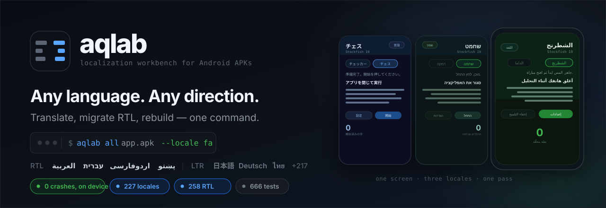
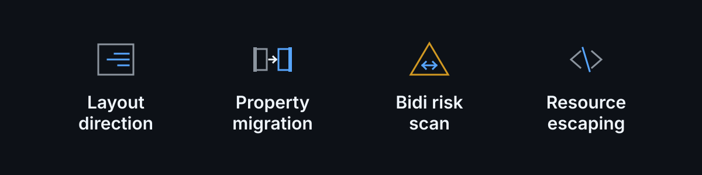
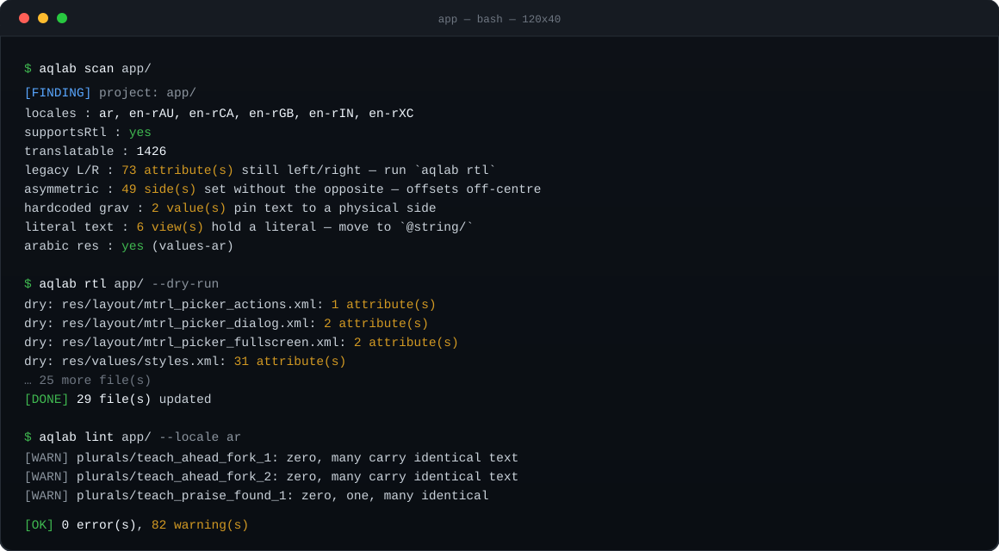
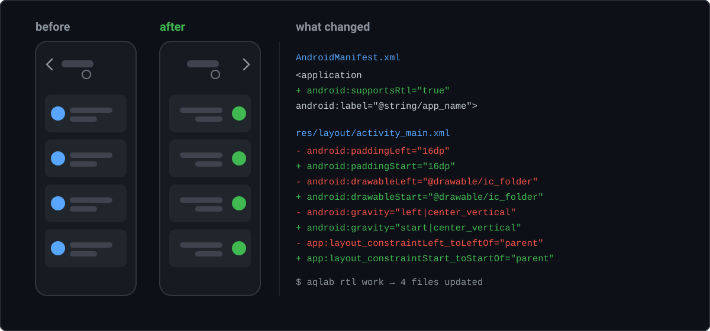

<div align="center">




**Any language. Any direction. One command.**

Turn any Android APK into a localized build — strings, layouts, RTL semantics, rebuilt and signed.

[](https://github.com/Gilgamesh-110/aqlab/actions/workflows/ci.yml)
[](https://pypi.org/project/aqlab/)
[](https://pypi.org/project/aqlab/)
[](LICENSE)
[](https://www.python.org/downloads/)
[](#requirements)
[](CONTRIBUTING.md)
[](CHANGELOG.md)
[](https://github.com/Gilgamesh-110/aqlab/releases/latest)
[](#requirements)
[](https://gilgamesh-110.github.io/aqlab/)

[العربية](README.ar.md) · **English** · [**Landing page**](https://gilgamesh-110.github.io/aqlab/)

</div>

---

Turn any Android APK into a localized build — strings, layouts, RTL semantics,
rebuilt and signed. Arabic is the hardest case and the one every check was
developed against: six plural forms, bidi mixing, mirror-image layouts. The
machinery underneath is script-agnostic — `--locale` takes any BCP-47 code,
227 have CLDR plural tables, 258 are right-to-left.

**`aqlab` does the part that is not translation** — layout direction, attribute
migration, Unicode bidi hazards, and Android resource escaping.

<p align="center">
  
</p>

<p align="center">
  
</p>

## Try it in 5 seconds

No APK and no Android SDK needed for this part — there is a small decoded project
in the repo that deliberately contains the traps:

```sh
git clone https://github.com/Gilgamesh-110/aqlab && cd aqlab
python aqlab.py rtl   examples/demo-project
python aqlab.py apply examples/demo-project --tsv examples/ar.tsv
python aqlab.py lint  examples/demo-project
```

```
[PATCH] AndroidManifest.xml: android:supportsRtl="true"
[PATCH] res/layout/activity_main.xml: 13 attribute(s)
[PATCH] res/layout/list_item.xml: 7 attribute(s)
[PATCH] res/values/styles.xml: 2 attribute(s)
[DONE] 4 file(s) updated
[DONE] 12 translation(s) -> examples/demo-project/res/values-ar/strings.xml
[FINDING] lint res/values-ar: 12/12 translated (100.0%)
  [ERROR] plurals/selected_count: missing quantities: few (3-10), many (11-99) — those counts fall back to `other`
  [WARN] plurals/selected_count: no zero (0), two (2) form — those counts use `other`
[FAIL] 1 error(s), 1 warning(s)
```

That last line is the reason this tool exists. The demo's Arabic is **100%
translated and still wrong** at every count above 2 — it says `3 عنصر` where
Arabic needs `3 عناصر`, `11 عنصراً` above ten and `لا عناصر` at zero. There is no
missing string, no build error and nothing an ordinary linter reports.

It contains a layout that declares `paddingLeft` **and** `paddingStart`, a
`<style>` that carries the direction in an `<item>` value, and a
`?listPreferredItemPaddingLeft` theme reference — the three things that break a
naive migration.

<p align="center">
  
</p>

## Contents

- [Try it in 5 seconds](#try-it-in-5-seconds)
- [Why](#why)
- [Install](#install)
- [Quick start](#quick-start)
- [Commands](#commands)
- [What it fixes](#what-it-fixes)
- [Bidi: what the linter does not claim](#bidi-what-the-linter-does-not-claim)
- [What it does *not* do](#what-it-does-not-do)
- [How this relates to other tools](#how-this-relates-to-other-tools)
- [Tested on](#tested-on)
- [FAQ](#faq)
- [Requirements](#requirements)
- [Docs](#docs)
- [Contributing](#contributing)
- [License](#license)

## Why

Arabic is written right-to-left. Android has had a first-class mechanism for this
since API 17 — logical `start`/`end` attributes plus `android:supportsRtl` — and
yet a large share of shipped apps never turned it on, or turned it on and left
hundreds of hardcoded `left`/`right` attributes behind.

Doing it by hand means auditing every layout, every menu, every style, and only
finding the mistakes when you look at the app running in Arabic. `aqlab`
automates the mechanical 95% and **lints the rest**, so the first Arabic build
you look at is already correct.

## Install

```sh
pip install aqlab        # or: pipx install aqlab
```

One file, standard library only, nothing else to install. Also available without a
package manager:

```sh
pipx install git+https://github.com/Gilgamesh-110/aqlab      # or
curl -O https://raw.githubusercontent.com/Gilgamesh-110/aqlab/main/aqlab.py
```

It drives tools you already have:

| tool | how it is found |
|---|---|
| `apktool` | `AQLAB_APKTOOL=/path/to/apktool.jar`, else `apktool` on `PATH` |
| `aapt2`, `zipalign`, `apksigner` | `ANDROID_HOME` / `AQLAB_SDK`, else `PATH` |

Per-tool overrides also work: `AQLAB_AAPT2`, `AQLAB_ZIPALIGN`, `AQLAB_APKSIGNER`,
`AQLAB_JAVA`.

## Quick start

```sh
aqlab scan app.apk          # what is the state of this app?
```

```
[FINDING] apk: app.apk
  package        : com.example.app
  label          : 'Example'
  locales        : 87 -> --_--, af, am, ar, as, az, be, bg, bn, bs, ca, cs, da, de
  arabic present : yes
  supportsRtl    : no (or not detectable in binary XML)
  native libs    : 6 (renaming packages in native apps can break self-checks)
```

```sh
aqlab decode app.apk -o work        # unpack
aqlab rtl    work --dry-run         # preview the migration
aqlab rtl    work                   # apply it
aqlab scaffold work                 # -> work/values-ar.tsv  (table stays out of res/)
#     ... translate the last column (DeepL, an LLM, or a human) ...
aqlab apply  work --tsv work/values-ar.tsv
aqlab lint   work                   # exits non-zero on real errors
aqlab build  work --ks release.keystore --ks-alias release
```

Or all of it at once — decode, migrate, import the table, lint, rebuild and sign,
one summary block, and the run stops at the first stage that fails:

```sh
aqlab all app.apk -o app-ar.apk --tsv ar.tsv --ks release.keystore --ks-alias release --report json
```

```
  [OK] decode
  [OK] rtl
  [OK] apply
  [OK] lint
  [OK] build
[DONE] aqlab all
  changes : 29 file(s) migrated
  lint    : 0 error(s), 82 warning(s) RtlSymmetry=49 RtlHardcoded=2
  output  : app-ar-aligned.apk
  project : app-decoded
  report  : app/aqlab-report.json
```

`all` decodes into a temporary directory and deletes it on the way out — an
existing `app-decoded/` beside the APK is left alone, and a report written by
`--report` defaults to `app/aqlab-report.json` beside the APK, not inside the
tree that is about to go.

Lint errors do not stop the build — an APK whose strings are not translated yet
still assembles — but the summary counts them and `all` exits non-zero.

## Commands

| command | what it does |
|---|---|
| `scan <apk\|dir>` | read-only report: locales, `supportsRtl`, remaining `left/right`, coverage. `--json` for tooling, `--jobs N` to spread the layout sweep (0 = every CPU; `$AQLAB_JOBS` sets the default). |
| `decode <apk>` | unpack an APK into an editable project. Skips `smali/` by default — see below. |
| `rtl <dir>` | set `android:supportsRtl` and migrate `left/right` → `start/end` across `res/**`. `--dry-run` to preview. |
| `scaffold <dir>` | create `res/values-<locale>/`, a translation TSV, and (API 33+) `res/xml/locales_config.xml` + `android:localeConfig`. Every `values/*.xml` is read, not just `strings.xml`. `--dry-run` to preview. |
| `apply <dir> --tsv` | import a translated table back into the locale folder, each entry into the file its source came from. `--dry-run` to preview. |
| `translate <dir> --tm tm.json` | fill `values-<locale>` from a translation memory: exact match, then fuzzy (`--threshold`, default 0.85), then `--translator cmd:<argv>` so an external service can fill what the memory could not. `--glossary` rewrites terms inside a match. A candidate with a different format signature is never a match (`%d` for `%1$s` throws at runtime), a plural category the source cannot declare is never filled from the `other` text, and everything unmatched is listed with `--unmatched-out`. No network. `--dry-run` to preview. |
| `lint <dir>` | escaping bugs, format-specifier drift, plural structure, coverage (overall and per file), text-like vectors, `RtlSymmetry` / `RtlHardcoded` / `RtlEnabled` (a `layoutDirection`/`textDirection` literal that beats the locale on an element with no physical attrs — `locale`, `firstStrong`-family, a mirrored-leaf `rtl`, a project-declared enum, an include-only clock/keypad row and every row of a build that sets `android:supportsRtl="false"` all stay silent, the opt-out itself being an error) / `supportsRtl` (an explicit `false` on `<application>` — RTL is off for the whole build and nothing can mirror; an absent attribute is not an error, it is what `aqlab rtl` adds) / `DirectionPins` (a pinned direction on a row, or on a container whose children set left/right), `ldrtl` drawable folders that are empty or hold a byte-identical copy of the LTR file. Non-zero exit on errors; `--fail-under` / `--fail-under-file` gate CI on coverage; `--fix` completes a missing `paddingStart`/`paddingEnd`-style partner, rewrites physical `gravity`/`textAlignment` values to `start`/`end`, migrates the physical attributes (and `gravity` values) of a row that only inherits a pinned direction, and drops a `layoutDirection="ltr"` pin set on the row itself, whether or not that row also carries physical attrs (migrating them with it; an `rtl` pin is a deliberate mirror and is kept) (`--fix --dry-run` plans all three). `--fix` also flips `android:supportsRtl="false"` — the one attribute, without the `aqlab rtl` migration and without its `minSdk`/`res/` requirements. |
| `build <dir>` | `apktool b` → `zipalign` → `apksigner sign` → `apksigner verify` |
| `diff <a.apk> <b.apk>` | added / removed / changed strings between two APKs, read straight from the resource table. Non-zero exit when they differ. |
| `xliff <dir>` | wrap every format specifier in `<xliff:g>` so a translator cannot reorder or drop it. `--dry-run` to preview. |
| `all <apk> -o out.apk` | the whole pipeline: decode, migrate, `--tsv` import, lint, rebuild, sign. One summary block; aborts at the first stage that fails, lint errors are counted but do not abort. |

### Speed, and why `decode` skips `smali/`

Disassembling the bytecode is most of the decode time, and this tool never edits
code — so it is skipped. `apktool` records the source APK in `apktool.yml` and
copies the original `classes*.dex` back on build **byte for byte**; the end-to-end
run below was verified with `sha256sum` on every dex, and the built APK passes
`apksigner verify` and `zipalign -c`.

Measured on a real 17 MB app — an 8,447-file tree, 125 layouts, 210 `values/`
files, 5 dex files:

| step | with `smali/` | default | what changed |
|---|---|---|---|
| `decode` | 52.1s | **10.0s** | skip the disassembly |
| `build` | 65.3s | **27.0s** | nothing to re-assemble |
| `rtl` | 6.6s | **4.3s** | tags that cannot migrate are skipped |
| **whole pipeline** | ~117s | **51s** | signed and verified |

`rtl` got faster because the rename tables used to run over *every attribute of
every element*. A tag is now skipped unless one of the names the tables know
about appears in it, so `layout_width` / `text` / `id` tags cost one substring
search. That cut pure-Python calls from 692k to 288k with byte-identical output.

Skipping `smali/` also shrinks the working tree from **123 MB across 8,447 files
to 47 MB across 1,197** — so every later copy, grep, archive and rebuild works on
a tree an order of magnitude smaller.

Need the smali tree after all? `--with-sources` on `decode` or `all`.

## What it fixes

* `android:supportsRtl="true"` on `<application>`
* `paddingLeft/Right` → `paddingStart/End`, and the same for `layout_margin*`,
  `drawable*`, `layout_align*`, `layout_alignParent*`, `layout_to*Of`
* ConstraintLayout `app:layout_constraint{Left,Right}_to{Left,Right}Of` → `{Start,End}`
* `gravity` / `layout_gravity` / `foregroundGravity` value tokens
* `textAlignment` → `viewStart` / `viewEnd`
* `<item name="android:paddingLeft">` entries inside `<style>` blocks
* theme references that would otherwise keep resolving to the LTR value
  (`?listPreferredItemPaddingLeft` → `?…Start`)
* Android resource escaping: `'`, leading `@`/`?`, and significant
  leading/trailing spaces

Every rename is guarded: when a tag already declares the `start`/`end` twin, the
old attribute is **removed** instead of duplicated. That guard is the difference
between a project that builds and one that dies inside `aapt2` with
`error: duplicate attribute` — and it is why this works on AppCompat and Material
layouts, which routinely carry both.

### What `--fix` refuses to do, and why

Two repairs were removed after measuring them on real APKs, not fixtures. Both
looked like fixes and both changed what the app renders.

**It will not invent a symmetric partner.** A `paddingLeft` with no
`paddingRight` is not half a pair — it is an element parked against one edge on
purpose. On the Material layouts of one APK the fixer added 27 attributes across
16 files and every single one moved something: a `statusDot` carrying only
`marginEnd=8` gained a `marginStart`, a Spinner carrying only `marginStart`
gained a `marginEnd`. Android's own `RtlSymmetry` is a warning for exactly this
reason and never auto-fixes it. The check still reports; `--fix` leaves it.

**It will not strip a deliberate `ltr` pin.** `layoutDirection="ltr"` on an
element with no physical attributes is a marker, not a redundant literal. On a
media app the fixer removed it from the ExoPlayer control views, which would
render play/pause/skip backwards under Arabic — the icons travel with the
layout and only the pin holds them in playback order. Pins *over* physical
attributes are still dropped and their attributes still migrate.

Measured after both removals on two real APKs (1,043 layouts total): second
`--fix` pass changes **0 files**, invented attributes **0**, deliberate pins
stripped **0**, XML parses **100%**. One APK was then rebuilt, signed and
installed on a device: 0 crashes, Arabic RTL intact.

## Bidi: what the linter does not claim

Mixed Arabic and Latin in one string is common and usually correct. `الإصدار
2.1` renders the way a reader expects with no help, and so does `المجلد test.`.

Earlier versions of this tool reported those as Bidi hazards and prescribed
`U+200F`. That was wrong, and it was measured wrong:

| | claimed | measured |
|---|---|---|
| strings checked | — | 200 mixed strings from a shipped APK |
| device | — | Android 11, `TextView`, `TEXT_DIRECTION_RTL` |
| defects found | 58 errors, then 534 findings | **0** |

Every character's resolved direction and horizontal span was read out of the
laid-out `android.text.Layout` and compared against UAX #9. The sentence-final
period of `المجلد test.` already sits to the left of `test`, which is where a
reader expects it; inserting `U+200F` before it moved nothing. The rule was
built by reasoning over character classes instead of measuring, so it fired on
correct text and buried the findings that matter.

The check is gone. What `lint` reports now is what it can demonstrate:

```
[FINDING] lint res/values-ar: 148/190 translated (77.9%)
  [WARN]  abc_menu_ctrl_shortcut_label: identical to source and contains Latin — probably untranslated
  [ERROR] discount: bare `%` — must be `%%` or a format specifier, aapt will reject it
  [ERROR] welcome: format specifiers differ: source ['%1$s'] vs arabic ['%s']
  [ERROR] note: unescaped apostrophe — use \' inside Android string resources
  [ERROR] plurals/selected_count: missing quantities: few (3-10), many (11-99)
[FAIL] 4 error(s), 1 warning(s)
```

If you do find text that renders wrong on a device, that is a bug report worth
filing — with the string, the device, and a screenshot. It is not something this
linter will guess at.

| rule | level |
|---|---|
| format specifiers differ from the source | error |
| bare `%` that `aapt` will reject | error |
| unescaped `'` inside a string resource | error |
| value starts with `@` or `?` | error |
| markup tags (`<b>`, `<xliff:g>`) differ from the source | error |
| an Arabic `<plurals>` missing `other`, `few` or `many` | error |
| value identical to the source and contains Latin | warn |
| no Arabic characters in the Arabic value | warn |
| leading/trailing space mismatch | warn |
| `few` / `many` / `other` carrying identical text | warn |
| an Arabic `<plurals>` missing `zero` or `two` | warn |
| a vector drawable that looks like lettering | warn |
| mixed Arabic + Latin in one string | info |

### Vector drawables with baked-in text

A Latin wordmark drawn as `<path>` geometry cannot mirror with the UI — the rest
of the screen flips and the logo stays pointing the wrong way. `lint` and `scan`
report those, and never touch the drawing.

Three conditions must all hold, because a warning about a correct file teaches
the user to ignore warnings:

1. it is a `<vector>` — not a `<shape>` or a `<layer-list>`, which are
   backgrounds whatever they are named
2. it does not set `android:autoMirrored="true"` — that vector mirrors itself
3. it has 12 or more paths — lettering is many separate contours, an icon is a
   handful

The threshold is measured, not guessed: in one real APK of 215 drawables, 86 are
vectors and **every one of them is 2 paths**. A rule keyed on filenames would
have flagged `bg_elo_badge.xml` (a `<shape>` background) and
`abc_ic_arrow_drop_right_black_24dp.xml` (already auto-mirrored).

```
[WARN] res/drawable/logo_wordmark.xml: 20 paths at 120.0x32.0dp — looks like
       lettering baked into geometry; it will not mirror with the UI, check it by eye
```

### The per-app language picker (Android 13+)

`scaffold` writes `res/xml/locales_config.xml` listing every `values-*` language
folder and points `android:localeConfig` at it, so the app appears in the system
per-app language picker. Without it a user on an English phone cannot switch
just this app to its translated locale.

```xml
<locale-config xmlns:android="http://schemas.android.com/apk/res/android">
    <locale android:name="ar"/>
    <locale android:name="fr"/>
</locale-config>
```

It is skipped below `minSdkVersion 33` (the API did not exist), disabled entirely
by `--no-locale-config`, and left alone when the app already declares its own
config — the run tells you which attribute it found instead. Qualifier folders
(`values-sw600dp`, `values-night`) are not languages and are excluded.

### Protecting placeholders from a translator

A bare `%1$s` in a translated string is fragile: a translator — human or machine —
can reorder it, pluralise it, or drop it, and the app then crashes at
`String.format` with an argument mismatch. Wrapping it tells the tool not to:

```xml
<string name="welcome">مرحباً <xliff:g id="arg1">%1$s</xliff:g>، لديك <xliff:g id="arg2">%2$d</xliff:g></string>
```

```bash
aqlab xliff proj --locale ar
```

The id comes from the specifier's own index (`%2$d` → `arg2`), so it stays
stable across re-translation instead of shifting with word order. `%%` is a
literal percent and is left alone, and an existing `<xliff:g>` is not wrapped
twice. Verified with aapt2: the file compiles, links, and the resolved value is
the bare `%1$s` again — the tag exists only in the source.

### Comparing two APKs

```bash
aqlab diff Chess_v2.apk Chess_v3.apk --locale ar
```

```
[FINDING] diff [ar]: Chess_v2.apk -> Chess_v3.apk
  strings        : 2998 -> 2998
  added          : 1
  removed        : 1
  changed        : 1

  changed:
    ~ (ar) changing
        - قبل
        + بعد
```

Read straight from `aapt2 dump resources`, so neither APK is decoded — no
50-second apktool run per side and no working copies to clean up. Text that did
not change is never listed; it is the majority of any diff and would bury the
real changes. Exit code is 0 when the two are identical, so CI can gate on drift.

### Any language, any direction

The plural tables and the `supportsRtl` machinery are not Arabic-specific.
`--locale` takes any BCP-47 tag: 227 have a CLDR plural table, 258 are
right-to-left. Categories differ per language, and they are genuinely different:

| locale | direction | categories | `many` means |
|---|---|---|---|
| `ar` | RTL | `zero one two few many other` | 11–99 |
| `he` | RTL | `one two other` | — |
| `fa` | RTL | `one other` | — |
| `ur` | RTL | `one other` | — |
| `pl` | LTR | `one few many other` | fractions |
| `ja` | LTR | `other` | — |

```bash
aqlab scaffold proj --locale he
aqlab lint proj --locale he
```

Asking Hebrew for a `few` form, or Persian for `zero`, would leave a form on the
translator that the language never uses — so the tables come from
[CLDR](https://www.unicode.org/cldr/charts/47/supplemental/language_plural_rules.html),
not from Arabic by analogy.

### Trying a command without running it

Every command that writes takes `--dry-run`, and prints the exact plan:

```
$ aqlab apply proj --tsv ar.tsv --dry-run
[DRY] would write 3 file(s) from 1424 translation(s)
  would overwrite: proj/res/values-ar/strings.xml (1370 entries)
  would overwrite: proj/res/values-ar/plurals.xml (54 entries)
  would create: proj/values-ar.tsv (1462 entries)
```

Writes are collected and applied together, so a failure part-way through leaves
the locale folder as it was rather than half-rewritten.

### Coverage as a gate

`lint` reports coverage per source file, because one number hides the file that
is behind — 88% overall can be `strings.xml` at 99% and `plurals.xml` at 60%:

```
[FINDING] lint res/values-ar: 1388/1426 translated (97.3%)
            strings.xml          1370/1408   97.3%  <- weakest
            plurals.xml          18/18  100.0%
```

Gate it in CI:

```bash
aqlab lint proj --fail-under 95            # overall
aqlab lint proj --fail-under-file 90       # any single file
aqlab lint proj --fix --dry-run            # plan the partner fills, gravity + pin rewrites
```

Exit code is non-zero on errors, so it drops straight into CI.

### A report CI can read

```
aqlab lint proj --report json              # -> proj/aqlab-report.json
aqlab lint proj --report html -o r.html    # one file, no CDN, opens anywhere
aqlab scan app.apk --report json -o a.json # same shape, from the APK's own facts
aqlab translate proj --tm tm.json --report json --dry-run
```

The JSON is schema-versioned (`schema: 1`) and byte-stable between runs on the
same tree, so it diffs in a PR. Every finding carries the rule that produced it;
the per-rule table sums to the finding list, so nothing can fall out of it.

`lint`, `scan` and `translate` all write that one schema; the `command` field says
which stage produced it. `scan` reports manifest/locale facts as findings and
leaves the coverage block empty rather than inventing a 0%; `translate` records
coverage, the match breakdown (`exact`/`fuzzy`/`kept`/`cmd`) and one finding per
unmatched key. `--dry-run` still writes the report: previewing the gaps is what
a report is for.

## The other part nobody does: six plural forms, not two

English has two plural forms (`one`, `other`). Arabic has **six**, Hebrew four,
Japanese one, Polish four. The gap is not a detail — it is the difference
between a translated app and a correct one. Arabic is the case shown here
because it is the hardest: the two categories that cover almost every count —
`few` (3–10) and `many` (11–99) — are exactly the two an English source cannot
hand you.

```
count  0     1       2       3-10       11-99      100, 101, …
       zero  one     two     few        many       other
       لا    عنصر     عنصران   %d عناصر    %d عنصراً    %d عنصر
```

So the standard outcome is an Arabic `<plurals>` that mirrors the English one —
two categories, both in Arabic words. It compiles. It links. **Nothing in the
build says a word.** And then every count from 2 upward falls through to `other`:

```
3   عنصر     ← should be  3 عناصر
15  عنصر     ← should be  15 عنصراً
```

`aqlab lint` reads `<plurals>` as a structure and reports it:

```
[ERROR] plurals/n_items: missing quantities: few (3-10), many (11-99)
        — those counts fall back to `other`
[WARN]  plurals/n_items: no zero (0), two (2) form — those counts use `other`
[WARN]  plurals/n_items: few, many, other carry identical text
        — the plural forms are not actually pluralised
```

Three things worth knowing about how this behaves:

* **Dropping the count in `zero`/`one`/`two` is not a finding.** `عنصر واحد` and
  `عنصران` are correct Arabic; only a *invented* placeholder is an error.
* **`other` missing is not a build failure.** Verified with `aapt2` — it compiles
  and links a locale whose `<plurals>` has no `other`. That is worse, not better:
  the counts simply have no Arabic value and nothing warns. This check is the only
  thing that will.
* **It reads every file in the locale folder, not just `strings.xml`.** Plurals
  normally live in their own `plurals.xml` — AOSP and most Material apps ship them
  that way, so a strings-only check would miss exactly the entries it exists for.

### Supplying the missing forms

The translation table already carries a row for **all six categories**, including
the ones an English source has no line for — otherwise there is nowhere to write
them, and `apply` would have nothing to read back:

```
aqlab scaffold work        # work/values-ar.tsv
    n_items|zero      ← blank: Arabic-only categories get a row of their own
    n_items|one       %d item
    n_items|two
    n_items|few
    n_items|many
    n_items|other     %d items

aqlab apply  work --tsv work/values-ar.tsv
```

Each entry goes back into the file its source came from, so an app that keeps
`values/plurals.xml` gets `values-ar/plurals.xml`. Nothing is funnelled into
`strings.xml`, because a `<plurals>` name declared in two files of one locale is
a duplicate-resource error. The table itself lives at `work/values-ar.tsv`, not
inside `res/` — a `.tsv` under `res/` makes `aapt2 compile --dir res` fail.

## What it does *not* do

* **It does not translate by itself.** `translate` replays a translation memory and a
  glossary you supply, and leaves every other key empty and named. It calls no service:
  the text of an unmatched key stays in the source language, and the mechanics
  (format specifiers, plural categories, escaping) survive when it is filled.
* It does not touch strings compiled into DEX/smali or native code.
* It does not mirror images or vector assets with baked-in Latin text.
* It deliberately does not force `android:layoutDirection="rtl"` — that would
  break every other locale in a multi-language app. `supportsRtl` with
  `start`/`end` is the correct mechanism, and it is what Google's own
  documentation specifies.

## How this relates to other tools

| tool | what it does | where it stops |
|---|---|---|
| **Android Lint** (`RtlHardcoded`, `RtlEnabled`) | flags hardcoded `left`/`right` in a **source** project, and Android Studio can auto-fix them | needs source and a working build. It cannot see an APK. Says nothing about bidi in translated strings or `%1$s` drift. |
| **Android Studio translation editor** | tracks which strings are translated | manages text, not direction. Does not touch a layout. |
| **`android:layoutDirection="rtl"`** | forces a subtree right-to-left | the common wrong fix — it breaks every other locale in a multi-language app. |
| **Machine translation** (DeepL, Google, an LLM) | translates the strings | will happily turn `%1$s` into `%s`, and cannot see a layout at all. |
| **Crowdin / Lokalise / Weblate** | orchestrates translators and review | upstream of the layout work; no RTL mechanics, no bidi linting. |
| **`apktool` alone** | gives you a decoded project | does none of the migration, and hands you the duplicate-attribute trap for free. |
| **`aqlab`** | sets `supportsRtl`, migrates the attributes, scaffolds and applies the translation table, lints bidi and resource escaping | operates on a **decoded APK** — no source needed. Does not translate anything. |

**When not to use this.** If you have the project source and a working build, use
Android Lint's `RtlHardcoded` and `RtlEnabled` checks — that is the right tool, it
runs in your build, and it is maintained by the people who make the platform.
`aqlab` exists for the other case: an APK and no source, or a source tree that no
longer builds.

## Tested on

Real APKs, end to end (`decode` → `rtl` → `build` → sign → verify) — not just
unit tests. `supportsRtl=true` is read back out of the **compiled** manifest, and
the output is checked with `apksigner verify` and `zipalign -c -v 4`:

| app | locales | rebuilt | signed | `supportsRtl` in compiled manifest |
|---|---|---|---|---|
| multi-language app (`com.gilgamesh.vip`) | 87 | yes | yes | ✅ `true` |
| utility app (`TS_Vip_v115`) | — | yes | yes | ✅ `true` |
| utility app (`bs_1.0`) | — | yes | yes | ✅ `true` |

The `rtl` pass is idempotent: running it a second time reports
`already RTL-clean — nothing to migrate` and writes nothing.

## FAQ

**A build failed with `error: duplicate attribute`.**
You are on a version before the twin guard. Update, or open an issue with the
file named in the error.

**It refuses to run with `minSdkVersion=15`.**
`start`/`end` resources do not exist before API 17. Raise `minSdkVersion`, or
pass `--force-min-sdk` knowing the build will then fail.

**The rebuilt app crashes, or detects that it was modified.**
Expected when the original verifies its signature or dex checksums natively — a
rebuild changes both. See [SECURITY.md](SECURITY.md).

**Does it work for Hebrew, Persian or Urdu?**
Yes, and for Japanese or German. `rtl`, `lint` and the attribute tables are
script-agnostic, `--locale` takes any BCP-47 tag, and the plural tables come
from CLDR per language — 227 of them, 258 of those languages right-to-left.
Arabic is the case the checks were built against because it is the hardest:
six plural categories against an English source's two, plus bidi.

**Why not just use Android Studio's RTL preview?**
That shows you *a* layout. This fixes every layout in the app and tells you which
strings are still broken.

## Requirements

Python 3.9+, `apktool`, and Android SDK build-tools (`aapt2`, `zipalign`,
`apksigner`). Nothing else — no pip dependencies, no `lxml`, no `androguard`.

## Docs

| | |
|---|---|
| [docs/bidi.md](docs/bidi.md) | the long version of bidi: the algorithm, which marks to use and when, and what the linter can and cannot see |
| [docs/troubleshooting.md](docs/troubleshooting.md) | `duplicate attribute`, `minSdkVersion`, missing tools, a rebuilt app that crashes, translations that do not show up |
| [CHANGELOG.md](CHANGELOG.md) | release history |
| [SECURITY.md](SECURITY.md) | threat model, signing-key hygiene, untrusted APK input |

## Contributing

See [CONTRIBUTING.md](CONTRIBUTING.md). The test suite is plain asserts and runs
anywhere:

```sh
python tests/test_aqlab.py       # 653 checks, no framework, no network, no apktool
```

Most wanted: more vector-drawable mirroring cases, and locale files nobody has
tested yet. See [CHANGELOG.md](CHANGELOG.md).

## License

MIT — see [LICENSE](LICENSE).

## Disclaimer

Run it on apps you own or are permitted to modify. Redistributing a rebuilt APK
may infringe the original app's licence or a store's terms of service. That is
your call, not the tool's.
