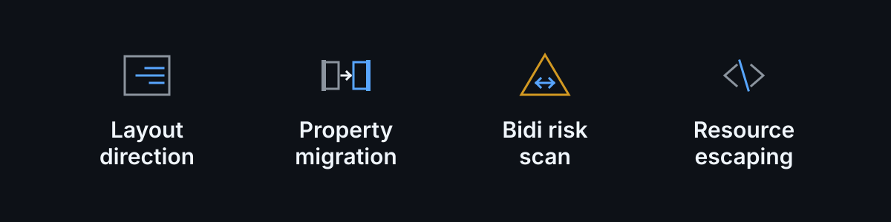
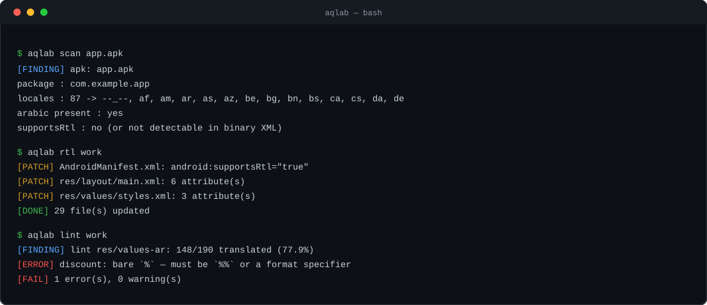
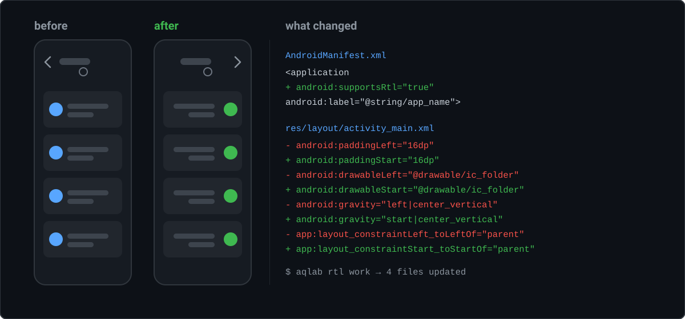

<div align="center">


**Flip any Android app to Arabic — RTL-correct — in one command.**

[](https://github.com/Gilgamesh-110/aqlab/actions/workflows/ci.yml)
[](LICENSE)
[](https://www.python.org/downloads/)
[](#requirements)
[](CONTRIBUTING.md)
[](CHANGELOG.md)
[](https://github.com/Gilgamesh-110/aqlab/releases/latest)
[](#requirements)

[العربية](README.ar.md) · **English**

</div>

---

Translating an app into Arabic is the easy half. The half almost everybody gets
wrong is the interface: the drawer stays on the left, the back arrow still points
left, progress bars fill left-to-right, `%d` placeholders go missing, and
punctuation lands on the wrong side of the line.

**`aqlab` does the part that is not translation** — layout direction, attribute
migration, Unicode bidi hazards, and Android resource escaping.

<p align="center">
  
</p>

<p align="center">
  
</p>

## Try it in 5 seconds

No APK and no Android SDK needed for this part — there is a small decoded project
in the repo that deliberately contains the traps:

```sh
git clone https://github.com/Gilgamesh-110/aqlab && cd aqlab
python aqlab.py rtl   examples/demo-project
python aqlab.py apply examples/demo-project --tsv examples/ar.tsv
python aqlab.py lint  examples/demo-project
```

```
[PATCH] AndroidManifest.xml: android:supportsRtl="true"
[PATCH] res/layout/activity_main.xml: 11 attribute(s)
[PATCH] res/layout/list_item.xml: 6 attribute(s)
[PATCH] res/values/styles.xml: 2 attribute(s)
[DONE] 4 file(s) updated
[DONE] 12 translation(s) -> examples/demo-project/res/values-ar/strings.xml
[FINDING] lint res/values-ar: 12/12 translated (100.0%)
  [ERROR] plurals/selected_count: missing Arabic quantities: few (3-10), many (11-99) — those counts fall back to `other`
  [WARN] plurals/selected_count: no zero (0), two (2) form — those counts use `other`
[FAIL] 1 error(s), 1 warning(s)
```

That last line is the reason this tool exists. The demo's Arabic is **100%
translated and still wrong** at every count above 2 — it says `3 عنصر` where
Arabic needs `3 عناصر`, `11 عنصراً` above ten and `لا عناصر` at zero. There is no
missing string, no build error and nothing an ordinary linter reports.

It contains a layout that declares `paddingLeft` **and** `paddingStart`, a
`<style>` that carries the direction in an `<item>` value, and a
`?listPreferredItemPaddingLeft` theme reference — the three things that break a
naive migration.

<p align="center">
  
</p>

## Contents

- [Try it in 5 seconds](#try-it-in-5-seconds)
- [Why](#why)
- [Install](#install)
- [Quick start](#quick-start)
- [Commands](#commands)
- [What it fixes](#what-it-fixes)
- [The part nobody else does: bidi linting](#the-part-nobody-else-does-bidi-linting)
- [What it does *not* do](#what-it-does-not-do)
- [How this relates to other tools](#how-this-relates-to-other-tools)
- [Tested on](#tested-on)
- [FAQ](#faq)
- [Requirements](#requirements)
- [Docs](#docs)
- [Contributing](#contributing)
- [License](#license)

## Why

Arabic is written right-to-left. Android has had a first-class mechanism for this
since API 17 — logical `start`/`end` attributes plus `android:supportsRtl` — and
yet a large share of shipped apps never turned it on, or turned it on and left
hundreds of hardcoded `left`/`right` attributes behind.

Doing it by hand means auditing every layout, every menu, every style, and only
finding the mistakes when you look at the app running in Arabic. `aqlab`
automates the mechanical 95% and **lints the rest**, so the first Arabic build
you look at is already correct.

## Install

```sh
pipx install git+https://github.com/Gilgamesh-110/aqlab      # or
curl -O https://raw.githubusercontent.com/Gilgamesh-110/aqlab/main/aqlab.py
```

One file, standard library only. It drives tools you already have:

| tool | how it is found |
|---|---|
| `apktool` | `AQLAB_APKTOOL=/path/to/apktool.jar`, else `apktool` on `PATH` |
| `aapt2`, `zipalign`, `apksigner` | `ANDROID_HOME` / `AQLAB_SDK`, else `PATH` |

Per-tool overrides also work: `AQLAB_AAPT2`, `AQLAB_ZIPALIGN`, `AQLAB_APKSIGNER`,
`AQLAB_JAVA`.

## Quick start

```sh
aqlab scan app.apk          # what is the state of this app?
```

```
[FINDING] apk: app.apk
  package        : com.example.app
  label          : 'Example'
  locales        : 87 -> --_--, af, am, ar, as, az, be, bg, bn, bs, ca, cs, da, de
  arabic present : yes
  supportsRtl    : no (or not detectable in binary XML)
  native libs    : 6 (renaming packages in native apps can break self-checks)
```

```sh
aqlab decode app.apk -o work        # unpack
aqlab rtl    work --dry-run         # preview the migration
aqlab rtl    work                   # apply it
aqlab scaffold work                 # -> work/values-ar.tsv  (table stays out of res/)
#     ... translate the last column (DeepL, an LLM, or a human) ...
aqlab apply  work --tsv work/values-ar.tsv
aqlab lint   work                   # exits non-zero on real errors
aqlab build  work --ks release.keystore --ks-alias release
```

Or all of it at once:

```sh
aqlab all app.apk --tsv ar.tsv --ks release.keystore --ks-alias release
```

## Commands

| command | what it does |
|---|---|
| `scan <apk\|dir>` | read-only report: locales, `supportsRtl`, remaining `left/right`, coverage. `--json` for tooling. |
| `decode <apk>` | unpack an APK into an editable project. Skips `smali/` by default — see below. |
| `rtl <dir>` | set `android:supportsRtl` and migrate `left/right` → `start/end` across `res/**`. `--dry-run` to preview. |
| `scaffold <dir>` | create `res/values-ar/` and a `values-ar.tsv` translation table. Every `values/*.xml` is read, not just `strings.xml`. |
| `apply <dir> --tsv` | import a translated table back into `values-ar/`, each entry into the file its source came from |
| `lint <dir>` | bidi hazards, escaping bugs, format-specifier drift, Arabic plural structure, coverage. Non-zero exit on errors. |
| `build <dir>` | `apktool b` → `zipalign` → `apksigner sign` → `apksigner verify` |
| `all <apk>` | the whole pipeline |

### Speed, and why `decode` skips `smali/`

Disassembling the bytecode is most of the decode time, and this tool never edits
code — so it is skipped. `apktool` records the source APK in `apktool.yml` and
copies the original `classes*.dex` back on build **byte for byte**; the end-to-end
run below was verified with `sha256sum` on every dex, and the built APK passes
`apksigner verify` and `zipalign -c`.

Measured on a real 17 MB app — an 8,447-file tree, 125 layouts, 210 `values/`
files, 5 dex files:

| step | with `smali/` | default | what changed |
|---|---|---|---|
| `decode` | 52.1s | **10.0s** | skip the disassembly |
| `build` | 65.3s | **27.0s** | nothing to re-assemble |
| `rtl` | 6.6s | **4.3s** | tags that cannot migrate are skipped |
| **whole pipeline** | ~117s | **51s** | signed and verified |

`rtl` got faster because the rename tables used to run over *every attribute of
every element*. A tag is now skipped unless one of the names the tables know
about appears in it, so `layout_width` / `text` / `id` tags cost one substring
search. That cut pure-Python calls from 692k to 288k with byte-identical output.

Skipping `smali/` also shrinks the working tree from **123 MB across 8,447 files
to 47 MB across 1,197** — so every later copy, grep, archive and rebuild works on
a tree an order of magnitude smaller.

Need the smali tree after all? `--with-sources` on `decode` or `all`.

## What it fixes

* `android:supportsRtl="true"` on `<application>`
* `paddingLeft/Right` → `paddingStart/End`, and the same for `layout_margin*`,
  `drawable*`, `layout_align*`, `layout_alignParent*`, `layout_to*Of`
* ConstraintLayout `app:layout_constraint{Left,Right}_to{Left,Right}Of` → `{Start,End}`
* `gravity` / `layout_gravity` / `foregroundGravity` value tokens
* `textAlignment` → `viewStart` / `viewEnd`
* `<item name="android:paddingLeft">` entries inside `<style>` blocks
* theme references that would otherwise keep resolving to the LTR value
  (`?listPreferredItemPaddingLeft` → `?…Start`)
* Android resource escaping: `'`, leading `@`/`?`, and significant
  leading/trailing spaces

Every rename is guarded: when a tag already declares the `start`/`end` twin, the
old attribute is **removed** instead of duplicated. That guard is the difference
between a project that builds and one that dies inside `aapt2` with
`error: duplicate attribute` — and it is why this works on AppCompat and Material
layouts, which routinely carry both.

## The part nobody else does: bidi linting

Arabic runs right-to-left. Numbers, Latin words, file paths and `%1$s`
placeholders inside it run left-to-right. Where the two meet, the Unicode
Bidirectional Algorithm reorders runs and punctuation ends up on the wrong side.

```
text:     المجلد test.
renders:  المجلد test.          the period sits right of "test"; it should sit left
fix:      المجلد test\u200f.    U+200F RIGHT-TO-LEFT MARK pins it in place
```

`aqlab lint` finds that, plus the failures that actually break the build:

```
[FINDING] lint res/values-ar: 148/190 translated (77.9%)
  [WARN]  abc_menu_ctrl_shortcut_label: identical to source and contains Latin — probably untranslated
  [ERROR] discount: bare `%` — must be `%%` or a format specifier, aapt will reject it
  [ERROR] welcome: format specifiers differ: source ['%1$s'] vs arabic ['%s']
  [ERROR] note: unescaped apostrophe — use \' inside Android string resources
  [ERROR] folder: trailing Latin/digit run before punctuation — needs U+200F (RLM)
[FAIL] 4 error(s), 1 warning(s)
```

| rule | level |
|---|---|
| format specifiers differ from the source | error |
| bare `%` that `aapt` will reject | error |
| unescaped `'` inside a string resource | error |
| value starts with `@` or `?` | error |
| markup tags (`<b>`, `<xliff:g>`) differ from the source | error |
| trailing Latin/digit run before punctuation (needs U+200F) | error |
| an Arabic `<plurals>` missing `other`, `few` or `many` | error |
| value identical to the source and contains Latin | warn |
| no Arabic characters in the Arabic value | warn |
| leading/trailing space mismatch | warn |
| `few` / `many` / `other` carrying identical text | warn |
| an Arabic `<plurals>` missing `zero` or `two` | warn |
| mixed Arabic + Latin in one string | info |

Exit code is non-zero on errors, so it drops straight into CI.

## The other part nobody does: Arabic has six plurals, not two

English has two plural forms (`one`, `other`). Arabic has **six**, and the two
that cover almost every count — `few` (3–10) and `many` (11–99) — are exactly the
two an English source cannot hand you:

```
count  0     1       2       3-10       11-99      100, 101, …
       zero  one     two     few        many       other
       لا    عنصر     عنصران   %d عناصر    %d عنصراً    %d عنصر
```

So the standard outcome is an Arabic `<plurals>` that mirrors the English one —
two categories, both in Arabic words. It compiles. It links. **Nothing in the
build says a word.** And then every count from 2 upward falls through to `other`:

```
3   عنصر     ← should be  3 عناصر
15  عنصر     ← should be  15 عنصراً
```

`aqlab lint` reads `<plurals>` as a structure and reports it:

```
[ERROR] plurals/n_items: missing Arabic quantities: few (3-10), many (11-99)
        — those counts fall back to `other`
[WARN]  plurals/n_items: no zero (0), two (2) form — those counts use `other`
[WARN]  plurals/n_items: few, many, other carry identical text
        — the plural forms are not actually pluralised
```

Three things worth knowing about how this behaves:

* **Dropping the count in `zero`/`one`/`two` is not a finding.** `عنصر واحد` and
  `عنصران` are correct Arabic; only a *invented* placeholder is an error.
* **`other` missing is not a build failure.** Verified with `aapt2` — it compiles
  and links a locale whose `<plurals>` has no `other`. That is worse, not better:
  the counts simply have no Arabic value and nothing warns. This check is the only
  thing that will.
* **It reads every file in the locale folder, not just `strings.xml`.** Plurals
  normally live in their own `plurals.xml` — AOSP and most Material apps ship them
  that way, so a strings-only check would miss exactly the entries it exists for.

### Supplying the missing forms

The translation table already carries a row for **all six categories**, including
the ones an English source has no line for — otherwise there is nowhere to write
them, and `apply` would have nothing to read back:

```
aqlab scaffold work        # work/values-ar.tsv
    n_items|zero      ← blank: Arabic-only categories get a row of their own
    n_items|one       %d item
    n_items|two
    n_items|few
    n_items|many
    n_items|other     %d items

aqlab apply  work --tsv work/values-ar.tsv
```

Each entry goes back into the file its source came from, so an app that keeps
`values/plurals.xml` gets `values-ar/plurals.xml`. Nothing is funnelled into
`strings.xml`, because a `<plurals>` name declared in two files of one locale is
a duplicate-resource error. The table itself lives at `work/values-ar.tsv`, not
inside `res/` — a `.tsv` under `res/` makes `aapt2 compile --dir res` fail.

## What it does *not* do

* **It does not translate anything.** No machine translation, no AI. The last
  column of the TSV is your job — the tool guarantees the mechanics survive once
  it is filled.
* It does not touch strings compiled into DEX/smali or native code.
* It does not mirror images or vector assets with baked-in Latin text.
* It deliberately does not force `android:layoutDirection="rtl"` — that would
  break every other locale in a multi-language app. `supportsRtl` with
  `start`/`end` is the correct mechanism, and it is what Google's own
  documentation specifies.

## How this relates to other tools

| tool | what it does | where it stops |
|---|---|---|
| **Android Lint** (`RtlHardcoded`, `RtlEnabled`) | flags hardcoded `left`/`right` in a **source** project, and Android Studio can auto-fix them | needs source and a working build. It cannot see an APK. Says nothing about bidi in translated strings or `%1$s` drift. |
| **Android Studio translation editor** | tracks which strings are translated | manages text, not direction. Does not touch a layout. |
| **`android:layoutDirection="rtl"`** | forces a subtree right-to-left | the common wrong fix — it breaks every other locale in a multi-language app. |
| **Machine translation** (DeepL, Google, an LLM) | translates the strings | will happily turn `%1$s` into `%s`, and cannot see a layout at all. |
| **Crowdin / Lokalise / Weblate** | orchestrates translators and review | upstream of the layout work; no RTL mechanics, no bidi linting. |
| **`apktool` alone** | gives you a decoded project | does none of the migration, and hands you the duplicate-attribute trap for free. |
| **`aqlab`** | sets `supportsRtl`, migrates the attributes, scaffolds and applies the translation table, lints bidi and resource escaping | operates on a **decoded APK** — no source needed. Does not translate anything. |

**When not to use this.** If you have the project source and a working build, use
Android Lint's `RtlHardcoded` and `RtlEnabled` checks — that is the right tool, it
runs in your build, and it is maintained by the people who make the platform.
`aqlab` exists for the other case: an APK and no source, or a source tree that no
longer builds.

## Tested on

Real APKs, end to end (`decode` → `rtl` → `build` → sign → verify) — not just
unit tests. `supportsRtl=true` is read back out of the **compiled** manifest, and
the output is checked with `apksigner verify` and `zipalign -c -v 4`:

| app | locales | rebuilt | signed | `supportsRtl` in compiled manifest |
|---|---|---|---|---|
| multi-language app (`com.gilgamesh.vip`) | 87 | yes | yes | ✅ `true` |
| utility app (`TS_Vip_v115`) | — | yes | yes | ✅ `true` |
| utility app (`bs_1.0`) | — | yes | yes | ✅ `true` |

The `rtl` pass is idempotent: running it a second time reports
`already RTL-clean — nothing to migrate` and writes nothing.

## FAQ

**A build failed with `error: duplicate attribute`.**
You are on a version before the twin guard. Update, or open an issue with the
file named in the error.

**It refuses to run with `minSdkVersion=15`.**
`start`/`end` resources do not exist before API 17. Raise `minSdkVersion`, or
pass `--force-min-sdk` knowing the build will then fail.

**The rebuilt app crashes, or detects that it was modified.**
Expected when the original verifies its signature or dex checksums natively — a
rebuild changes both. See [SECURITY.md](SECURITY.md).

**Does it work for Hebrew, Persian or Urdu?**
The mechanics are identical — `rtl`, `lint` and the attribute tables are
script-agnostic, and `--locale` accepts any locale code. The Arabic-specific
parts are the plural rules and the bidi rules.

**Why not just use Android Studio's RTL preview?**
That shows you *a* layout. This fixes every layout in the app and tells you which
strings are still broken.

## Requirements

Python 3.9+, `apktool`, and Android SDK build-tools (`aapt2`, `zipalign`,
`apksigner`). Nothing else — no pip dependencies, no `lxml`, no `androguard`.

## Docs

| | |
|---|---|
| [docs/bidi.md](docs/bidi.md) | the long version of bidi: the algorithm, which marks to use and when, and what the linter can and cannot see |
| [docs/troubleshooting.md](docs/troubleshooting.md) | `duplicate attribute`, `minSdkVersion`, missing tools, a rebuilt app that crashes, translations that do not show up |
| [CHANGELOG.md](CHANGELOG.md) | release history |
| [SECURITY.md](SECURITY.md) | threat model, signing-key hygiene, untrusted APK input |

## Contributing

See [CONTRIBUTING.md](CONTRIBUTING.md). The test suite is plain asserts and runs
anywhere:

```sh
python tests/test_aqlab.py       # 85 checks, no framework, no network, no apktool
```

Most wanted: plural validation for the six Arabic forms, `android:localeConfig`
scaffolding for the Android 13+ per-app language picker, and vector-drawable
mirroring warnings. See [CHANGELOG.md](CHANGELOG.md).

## License

MIT — see [LICENSE](LICENSE).

## Disclaimer

Run it on apps you own or are permitted to modify. Redistributing a rebuilt APK
may infringe the original app's licence or a store's terms of service. That is
your call, not the tool's.
